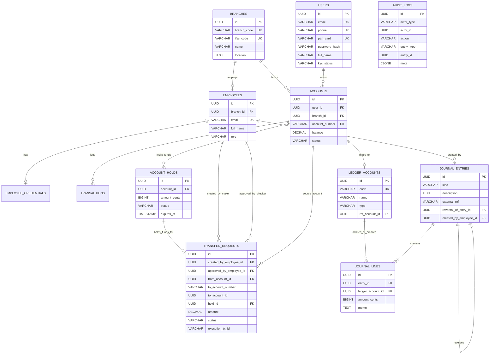

# ByteVault — Interview Cheat Sheet (Simple & Buzzword-Free)

> **What is ByteVault?**  
> A banking system that lets customers transfer money between two separate bank branch databases safely. It makes sure money is never lost or created out of nowhere, even if a server or network drops in the middle of a transfer.
>
> **Creators:** Anosh Chodankar & Anish Ghadi  
> **Tech Stack:** Next.js (Frontend), Bun + Express (Backend), 2 PostgreSQL Databases (Docker), TypeScript.

---

## Table of Contents
1. [The Elevator Pitch (How to Introduce the Project)](#1-the-elevator-pitch)
2. [Core Concepts in Plain English (No Buzzwords)](#2-core-concepts-in-plain-english)
3. [The Story of a $100 Transfer (Step-by-Step)](#3-the-story-of-a-100-transfer-step-by-step)
4. [Top 10 Common Interview Questions & Answers](#4-top-10-common-interview-questions--answers)
5. [Top 5 Tricky / Deep Questions & Answers](#5-top-5-tricky--deep-questions--answers)
6. [Honest Limitations & What You Would Improve](#6-honest-limitations--what-you-would-improve)
7. [Quick Memory Table (Flashcards)](#7-quick-memory-table)
8. [Database Deep-Dive & SQL Refresher (DDL, DML, DCL, TCL)](#8-database-deep-dive--sql-refresher-ddl-dml-dcl-tcl)
9. [Database Setup, Stored Procedures & Triggers](#9-database-setup-stored-procedures--triggers)
10. [Entity Relationship Diagram (ERD) & Schema Architecture](#10-entity-relationship-diagram-erd--schema-architecture)
11. [Codebase Architecture & File Structure](#11-codebase-architecture--file-structure)

---

## 1. The Elevator Pitch

### 30-Second Version (Say this when they ask: "Tell me about your project")
> *"ByteVault is a core banking system that handles money transfers between two separate bank branch databases. Most student projects put everything into one single database and just change a balance number. In real life, banks have separate databases for different branches. My project ensures that if Branch A sends money to Branch B, either both databases update together or neither does—so money never disappears if a server crashes halfway through."*

---

### 1-Minute Version (If they ask for a bit more detail)
> *"I built ByteVault to solve the classic 'lost money' problem in banking. If you take $100 out of Database A, and the network dies before it reaches Database B, $100 is lost in limbo.*
> 
> *To fix this, I focused on four main things:*
> 1. ***Two-Phase Commit:*** *Before saving any transfer, the backend asks both databases: 'Are you both ready?' Only if both say yes does it save the changes.*
> 2. ***Accountant's Ledger (Double-Entry):*** *We never just edit a balance number. Every transfer writes two matching records (a minus and a plus) that add up to zero, like an accountant's notebook.*
> 3. ***Two-Person Rule (Maker-Checker):*** *A clerk enters a transfer, but a manager has to approve it. While waiting for approval, the money is placed on hold so the customer can't spend it twice.*
> 4. ***End-of-Day Check:*** *At midnight, an automated script checks that all money sent between branches adds up to zero, and adds daily interest to savings accounts."*

---

## 2. Core Concepts in Plain English

### 1. Why Two Databases Instead of One?
* **Plain explanation:** Real banks don't put all their branches into one computer in one building. If that computer burns down or loses power, every branch in the country stops working. Having separate databases for separate branches keeps branches independent and follows banking regulations.

---

### 2. What is Two-Phase Commit (2PC)?
* **The Wedding Metaphor:** Think of a wedding ceremony.
  - **Phase 1 (Ask):** The priest asks person 1: *"Do you agree?"* and person 2: *"Do you agree?"* Both check themselves and say *"Yes"*.
  - **Phase 2 (Commit):** The priest says: *"I now pronounce you married."*
  - **What if someone says no?** If either person says no, or passes out, the wedding is called off immediately. Nobody gets married.
* **In ByteVault:**
  - The backend asks Database A: *"Can you deduct $100?"*
  - The backend asks Database B: *"Can you add $100?"*
  - If both say *"Yes, we checked the balance and locked the rows"*, the backend says: *"Commit!"*
  - If one database is down or errors, both databases cancel. No money is lost.

---

### 3. What is Double-Entry Bookkeeping?
* **Why not just change `balance = balance - 100`?**
  - If Alice had $500 yesterday and has $400 today, a single balance number can't tell you *why*. Did she buy something? Did an employee steal it? Did a database glitch wipe it out? You have no proof.
* **How double-entry works:**
  - You never edit the balance directly.
  - You write every money movement as a journal entry with two lines:
    - **Where money left:** -$100 (Alice)
    - **Where money arrived:** +$100 (Bob)
    - **Total sum:** -$100 + $100 = **$0**.
  - If the sum is ever not zero, someone created or lost money.
  - To find Alice's current balance, you simply add up all the history lines for Alice.

---

### 4. What is a "Clearing Account"?
* **The Problem:** Database A only knows about Branch A accounts. Database B only knows about Branch B accounts. How can you balance a journal entry if Alice is on DB A and Bob is on DB B?
* **The Solution:** We create a middleman bucket called `CLEARING_INTERBRANCH`.
  - **On Branch A:** Alice gets -$100, Clearing bucket gets +$100. (Sum on DB A = 0).
  - **On Branch B:** Clearing bucket gets -$100, Bob gets +$100. (Sum on DB B = 0).
  - At the end of the day, +$100 on DB A and -$100 on DB B cancel each other out to exactly **$0**.

---

### 5. What is "Maker-Checker" (The Two-Person Rule)?
* **Plain explanation:** One person enters the transfer, a different person approves it.
* **Why it matters:** If a junior bank teller could send money alone, they could send $100,000 to their own personal account and run away. With Maker-Checker, a manager must review and approve it first. It stops fraud and catches typing mistakes.

---

### 6. What is an "Account Hold"?
* **Plain explanation:** Putting money on "pause".
* **Why it matters:** Suppose Alice has $100 and asks to send $100 to Bob. While waiting 2 hours for the branch manager to approve the transfer, what stops Alice from running to an ATM and withdrawing that same $100?
* **How we fix it:**
  - Available balance = Actual balance - Holds.
  - As soon as the transfer is requested, we put a $100 hold on Alice's account.
  - Her available balance drops to $0 right away.
  - If the manager approves, the $100 is sent.
  - If the manager rejects, the hold is removed and Alice gets her $100 back.

---

### 7. Why Store Money in Cents / Paise (Whole Numbers)?
* **Plain explanation:** Computers are notoriously bad at decimal math.
  - If you type `0.1 + 0.2` into your browser console or Python, you get `0.30000000000000004`.
  - In a bank handling millions of transactions, these tiny decimal errors add up to real missing money.
* **Our solution:** We store all money as whole numbers (cents or paise). $10.50 is stored as the number `1050`. Whole number math is always 100% exact.

---

### 8. What is an Idempotency Key?
* **The Problem:** You click "Pay $50" on a website. Your internet lags. You click "Pay $50" again. You don't want to be charged twice.
* **The Solution:**
  - Every time the frontend sends a transfer request, it generates a unique random ID (like a tracking number).
  - The backend saves this ID.
  - If the user clicks again or the network retries with the same ID, the backend says: *"I already completed request #123. Here is the receipt."* It will not charge the user a second time.

---

### 9. What is Postgres FDW (Foreign Data Wrapper)?
* **Plain explanation:** It links two separate databases together inside SQL.
* **Why it helps:**
  - Normally, if Database A needs to see data in Database B, your backend has to query DB A, query DB B, and stitch the data together in JavaScript.
  - With Postgres FDW, Database A can see Database B's tables directly. You can write a single SQL query in Database A that reads from both branches at the same time.

---

### 10. What does the End of Day (EOD) Job do?
* **Plain explanation:** An automated cleanup and safety check run when the bank closes for the day.
* **The 3 things it does:**
  1. **Audit the math:** Adds up the clearing accounts between Branch A and Branch B. If the sum is not 0, it sounds an alarm.
  2. **Pay interest:** Calculates daily savings interest (4% per year) for active accounts.
  3. **Refresh summary tables:** Rebuilds pre-calculated daily balance tables so the dashboard loads instantly the next morning.

---

## 3. The Story of a $100 Transfer (Step-by-Step)

If an interviewer asks: *"Walk me through what happens under the hood when a customer sends $100 from Branch A to Branch B"*, tell this simple story:

1. **Step 1: The Request (Maker)**  
   The clerk (Maker) selects Alice (Branch A) and Bob (Branch B) for $100 and clicks Submit.
2. **Step 2: Balance Check & Hold**  
   The backend checks if Alice has at least $100. If yes, it creates an `account_hold` for $100. Alice's available balance is now $100 less. The transfer status is set to `PENDING`.
3. **Step 3: Manager Review (Checker)**  
   A branch manager logs into the checker dashboard, sees the pending $100 request, verifies the details, and clicks `Approve`.
4. **Step 4: Phase 1 of 2PC (The Question)**  
   The backend opens connections to Database A and Database B:
   - It tells DB A: *"Lock Alice's account, capture the $100 hold, and prepare to debit Alice."*
   - It tells DB B: *"Lock Bob's account and prepare to credit Bob $100."*
   - It asks both: *"Are you ready?"* Both write the change to their private log and reply *"Ready"*.
5. **Step 5: Phase 2 of 2PC (The Commit)**  
   Because both replied ready, the backend sends `COMMIT PREPARED` to both databases. Both databases permanently apply the change at the same time.
6. **Step 6: Completion**  
   The transfer request status is marked `EXECUTED`, and a permanent audit log is recorded.

---

## 4. Top 10 Common Interview Questions & Answers

### Q1: "Give me a quick overview of your tech stack and why you chose it."
> **Answer:**  
> *"On the frontend, I used **Next.js** because it gives us fast page loads and clean routing for customer and staff portals.  
> On the backend, I used **Bun with Express** in TypeScript. Bun runs TypeScript directly without slow build steps, and starts up fast.  
> For the database, I used two **PostgreSQL** instances in Docker. I chose PostgreSQL because banking needs strict ACID rules, row-level locks, and built-in support for Two-Phase Commit."*

---

### Q2: "Why PostgreSQL instead of MongoDB?"
> **Answer:**  
> *"In banking, correctness is everything. MongoDB is great for flexible, changing documents, but banking needs strict tables, foreign keys, and guarantees that negative balances cannot exist. PostgreSQL gives us row-locking (`SELECT FOR UPDATE`), strict constraints, and native support for distributed Two-Phase Commit (`PREPARE TRANSACTION`), which you can't get out of the box in simple NoSQL databases."*

---

### Q3: "Why not just update a balance column? Why write all those ledger lines?"
> **Answer:**  
> *"A balance column only tells you what someone has right now. It doesn't tell you how they got it. If an employee changes a balance from $1,000 to $500, you have zero proof of where that $500 went.  
> In our double-entry ledger, we never delete or change old records. Every transaction writes a plus and a minus line. The balance column is just a quick summary; the ledger lines are the legal proof."*

---

### Q4: "What happens if a user submits a transfer and their internet cuts out?"
> **Answer:**  
> *"That's why we use an **Idempotency Key**. The frontend generates a unique ID for each transfer. If the user's internet lags and they click the button again, the backend checks if it already saw that ID. If it did, it simply returns the existing receipt instead of executing the transfer a second time."*

---

### Q5: "How do you stop someone from spending the same $100 twice?"
> **Answer:**  
> *"We use two layers:  
> First, when a transfer is waiting for manager approval, we put an **Account Hold** on the money right away. Available balance equals ledger balance minus holds, so the money is locked immediately.  
> Second, when the transfer executes, we use PostgreSQL's `SELECT ... FOR UPDATE` row lock so two transactions can never touch the same account at the exact same millisecond."*

---

### Q6: "What is the difference between a Maker and a Checker?"
> **Answer:**  
> *"A Maker is the person who types in the transfer details. A Checker is the manager who reviews and clicks approve. The Maker cannot approve their own transfer. This two-person rule prevents dishonest employees from stealing money and catches accidental typos before money leaves the bank."*

---

### Q7: "Why did you store money as cents instead of decimals?"
> **Answer:**  
> *"Because computers make math mistakes with decimal numbers. In programming, `0.1 + 0.2` equals `0.30000000000000004` because of binary floating-point math. In banking, those tiny fraction errors add up to real missing money. Storing everything as whole integer cents or paise eliminates rounding errors completely."*

---

### Q8: "How does Branch A read data from Branch B?"
> **Answer:**  
> *"We use a PostgreSQL feature called **Foreign Data Wrapper (FDW)**. It lets Database A mount Database B's tables as if they were inside Database A. This means we can write a single SQL query to compare data across both branches without writing extra backend code to stitch the data together."*

---

### Q9: "If someone makes a fraudulent transfer, how do you fix it if you can't edit the ledger?"
> **Answer:**  
> *"We use a **Reversal**. We never delete or change the old transaction. Instead, we create a new entry with the exact opposite amounts to cancel it out, and link it to the old transaction ID. We also put a database rule that an entry can only be reversed once. This leaves an honest paper trail for auditors."*

---

### Q10: "What does the End-of-Day (EOD) batch script do?"
> **Answer:**  
> *"It runs three automated checks:  
> 1. It adds up the cross-branch clearing accounts to prove the net difference is exactly $0.  
> 2. It calculates daily compound interest for savings accounts.  
> 3. It refreshes our daily summary table so morning dashboard queries run fast."*

---

## 5. Top 5 Tricky / Deep Questions & Answers

### Q1: "What happens if the backend server crashes right after Phase 1 (Prepare) in 2PC? Do rows stay locked forever?"
> **Answer:**  
> *"When PostgreSQL executes `PREPARE TRANSACTION`, it saves the lock to disk. Even if the backend crashes or the database restarts, those locks stay held until someone issues `COMMIT PREPARED` or `ROLLBACK PREPARED`.  
> In ByteVault:  
> - If an error happens while running, the backend's catch block issues a rollback.  
> - If the backend server completely loses power, PostgreSQL keeps the prepared transactions listed in a built-in table called `pg_prepared_xacts`. When the server boots back up, a recovery script checks this table and finishes or cancels any stuck transactions."*

---

### Q2: "Can two people deadlock each other if they send money to each other at the same time?"
*(Example: Alice in Branch A sends to Bob in Branch B, while Bob sends to Alice at the exact same second.)*
> **Answer:**  
> *"Yes, if two transactions try to lock the same accounts in opposite order across databases, they could wait on each other forever.  
> We protect against this in two ways:  
> 1. **Lock Timeouts:** We set a 3-second lock timeout in PostgreSQL (`SET lock_timeout = 3000`). If a query cannot get a lock within 3 seconds, it cancels itself instead of hanging forever.  
> 2. **Account Holds:** We don't lock both accounts at the same time during the waiting period. We only lock the sender's account for a fraction of a second to place a hold. The actual transfer across both accounts only takes a few milliseconds during execution."*

---

### Q3: "What if a rogue employee tries to bypass the app and edit the database directly?"
> **Answer:**  
> *"We put security rules directly inside the PostgreSQL database using database triggers.  
> For example, we wrote a trigger `trg_large_transaction_guard`. If any transaction over ₹5,00,000 is inserted directly into the database with a 'COMPLETED' status, the database raises an error and blocks it. It forces the status to 'FLAGGED' and writes an alert to the audit log. Even if someone bypasses our backend API, the database itself enforces the rules."*

---

### Q4: "What happens if the End-of-Day clearing check fails (total is not $0)?"
> **Answer:**  
> *"If the clearing total is not zero, it means money was either created or lost—the worst possible bug in banking.  
> If our EOD script sees a non-zero number, it immediately stops, cancels the batch transaction, logs a critical error to the audit log, and alerts administrators. It refuses to calculate interest or roll over daily balances until a human investigates."*

---

### Q5: "What if an attacker tries to submit two identical transfer requests at the exact same millisecond?"
> **Answer:**  
> *"Our idempotency table has a database rule (`UNIQUE constraint`) on the request key.  
> When the first request hits, it inserts a row marked 'IN_PROGRESS'. If a second request hits at the exact same millisecond with the same key, the database rejects it with a unique constraint violation. The backend catches this and rejects the duplicate immediately."*

---

## 6. Honest Limitations & What You Would Improve

*(Interviewers love candidates who can honestly critique their own work! Memorize 2 or 3 of these points.)*

1. **Two-Phase Commit is slow if you have 50 branches:**  
   * *"2PC works great for 2 or 3 branches. But if you have 50 branches across the world, holding database locks over the internet makes everything slow. If I were building this for a national bank with millions of users, I would switch to an **event queue** (like Kafka). Branch A would deduct the money and post a message to the queue, and Branch B would pick up the message whenever it's ready."*
2. **The backend coordinator state is currently in memory:**  
   * *"Right now, the Two-Phase Commit coordinator logic lives in our Express backend. If the backend process crashes in the middle of a transfer, we have to look at the database to see what happened. In a larger production app, I would log every step of the transfer to a dedicated coordinator database table before sending the commit."*
3. **Caching for faster checks:**  
   * *"Currently, we check idempotency keys in PostgreSQL. If we had 10,000 requests per second, hitting PostgreSQL for every single check would slow it down. Using Redis with quick expiration times would make idempotency checks almost instant."*

---

## 7. Quick Memory Table (Flashcards)

| Word / Term | What it means in plain English | Why we use it |
| :--- | :--- | :--- |
| **Two-Phase Commit (2PC)** | Asking both databases *"Are you ready?"* before telling either to save. | Prevents money from being deducted on Branch A if Branch B crashes. |
| **Double-Entry** | Every transaction writes a plus line and a minus line that equal zero. | Creates an unbreakable paper trail so balances can always be verified. |
| **Maker-Checker** | One person types the transfer, a manager approves it. | Stops employee theft and catches typing errors. |
| **Account Hold** | Freezing the transfer amount temporarily. | Stops the customer from spending the money twice while waiting for approval. |
| **Integer Cents / Paise** | Storing $10.50 as the whole number `1050`. | Prevents decimal rounding errors in computer math. |
| **Idempotency Key** | A unique tracking number for each button click. | Stops double-charging if the user clicks "Pay" twice on a slow connection. |
| **Postgres FDW** | Letting Database A read tables in Database B directly in SQL. | Lets us check both databases in one query without messy backend code. |
| **Clearing Account** | A temporary middleman bucket between branches. | Keeps the accounting books balanced on both branches during a transfer. |
| **Reversal** | Adding an opposite transaction to cancel a mistake. | Fixes mistakes without ever deleting or changing old records. |
| **Lock Timeout** | Giving up after 3 seconds if a table row is busy. | Stops two transfers from getting stuck waiting for each other forever. |

---

## 8. Database Deep-Dive & SQL Refresher (DDL, DML, DCL, TCL)

### SQL Commands Overview Table

| Command Type | Full Name | Plain English Meaning | SQL Verbs | ByteVault Example |
| :--- | :--- | :--- | :--- | :--- |
| **DDL** | Data Definition Language | Creates or modifies database skeleton & rules | `CREATE`, `ALTER`, `DROP`, `TRUNCATE` | `CREATE TABLE accounts (...)`, `CREATE INDEX ...` |
| **DML** | Data Manipulation Language | Reads, inserts, edits, or deletes row data | `SELECT`, `INSERT`, `UPDATE`, `DELETE` | `UPDATE accounts SET balance = balance - 100` |
| **DCL** | Data Control Language | Manages user access, permissions, and security | `GRANT`, `REVOKE`, `CREATE USER MAPPING` | `CREATE USER MAPPING FOR CURRENT_USER SERVER sub_branch` |
| **TCL** | Transaction Control Language | Manages atomic operations & commits/rollbacks | `BEGIN`, `COMMIT`, `ROLLBACK`, `PREPARE` | `PREPARE TRANSACTION 'tx_01a'`, `COMMIT PREPARED` |

---

### Core DDL Queries in ByteVault

```sql
-- 1. Accounts Table (Checking positive balances)
CREATE TABLE accounts (
    id UUID PRIMARY KEY DEFAULT gen_random_uuid(),
    user_id UUID REFERENCES users(id) ON DELETE RESTRICT,
    branch_id UUID REFERENCES branches(id) ON DELETE RESTRICT,
    account_number VARCHAR(20) UNIQUE NOT NULL,
    balance DECIMAL(15, 2) NOT NULL DEFAULT 0.00 CHECK (balance >= 0),
    status VARCHAR(20) NOT NULL DEFAULT 'ACTIVE' CHECK (status IN ('ACTIVE', 'FROZEN', 'CLOSED')),
    updated_at TIMESTAMP WITH TIME ZONE DEFAULT CURRENT_TIMESTAMP,
    created_at TIMESTAMP WITH TIME ZONE DEFAULT CURRENT_TIMESTAMP
);

-- 2. Account Holds (Funds frozen during Maker-Checker approval)
CREATE TABLE account_holds (
    id UUID PRIMARY KEY DEFAULT gen_random_uuid(),
    account_id UUID NOT NULL REFERENCES accounts(id) ON DELETE CASCADE,
    amount_cents BIGINT NOT NULL CHECK (amount_cents > 0),
    reason VARCHAR(200),
    status VARCHAR(20) NOT NULL DEFAULT 'ACTIVE' CHECK (status IN ('ACTIVE', 'RELEASED', 'CAPTURED', 'EXPIRED')),
    expires_at TIMESTAMP WITH TIME ZONE,
    created_at TIMESTAMP WITH TIME ZONE DEFAULT CURRENT_TIMESTAMP,
    released_at TIMESTAMP WITH TIME ZONE
);

-- 3. Double-Entry Journal Lines (Signed cents; total across entry sums to 0)
CREATE TABLE journal_lines (
    id UUID PRIMARY KEY DEFAULT gen_random_uuid(),
    entry_id UUID NOT NULL REFERENCES journal_entries(id) ON DELETE CASCADE,
    ledger_account_id UUID NOT NULL REFERENCES ledger_accounts(id) ON DELETE RESTRICT,
    amount_cents BIGINT NOT NULL CHECK (amount_cents <> 0),
    memo TEXT,
    created_at TIMESTAMP WITH TIME ZONE DEFAULT CURRENT_TIMESTAMP
);

-- 4. Materialized View for instant daily balance rollups
CREATE MATERIALIZED VIEW IF NOT EXISTS ledger_daily_balances AS
SELECT 
    ledger_account_id,
    DATE(created_at) AS balance_date,
    SUM(amount_cents) AS daily_net_cents
FROM journal_lines
GROUP BY ledger_account_id, DATE(created_at);
```

---

### Core DML Queries in ByteVault

```sql
-- Row-level locking to prevent race conditions (Double-spending)
SELECT id FROM accounts WHERE id = $1 FOR UPDATE;

-- Placing an active hold on funds when Maker submits transfer
INSERT INTO account_holds (account_id, amount_cents, reason, status)
VALUES ($1, $2, 'Transfer Request', 'ACTIVE') RETURNING id;

-- Capturing hold upon manager approval
UPDATE account_holds 
SET status = 'CAPTURED', released_at = CURRENT_TIMESTAMP 
WHERE id = $1 AND status = 'ACTIVE';

-- Writing balanced journal lines
INSERT INTO journal_lines (entry_id, ledger_account_id, amount_cents, memo)
VALUES 
    ($entry_id, $from_ledger_account_id, -10000, 'Interbranch debit'),
    ($entry_id, $clearing_ledger_account_id, +10000, 'Interbranch clearing credit');
```

---

### Core DCL Queries (Postgres FDW)

```sql
-- Link Branch A (Main) to Branch B (Sub) over Docker network
CREATE EXTENSION IF NOT EXISTS postgres_fdw;

CREATE SERVER IF NOT EXISTS sub_branch
    FOREIGN DATA WRAPPER postgres_fdw
    OPTIONS (host 'branch_b_db', port '5432', dbname 'branch_b_db');

CREATE USER MAPPING IF NOT EXISTS FOR CURRENT_USER 
    SERVER sub_branch
    OPTIONS (user 'admin_b', password 'secure_password_b');

IMPORT FOREIGN SCHEMA public
    LIMIT TO (branches, users, employees, accounts, transactions, ledger_accounts, journal_lines)
    FROM SERVER sub_branch
    INTO fdw_sub;
```

---

### Core TCL Queries (Distributed Two-Phase Commit - 2PC)

```sql
-- Phase 1: Begin & Prepare
-- (Executed on both Branch A and Branch B connections concurrently)
BEGIN;
SET statement_timeout = 5000;
SET lock_timeout = 3000;
-- ... [execute balance deductions, ledger entries, row locks] ...
PREPARE TRANSACTION 'tx_987654_A'; -- Branch A
PREPARE TRANSACTION 'tx_987654_B'; -- Branch B

-- Phase 2: Commit (only if BOTH databases succeeded in Phase 1)
COMMIT PREPARED 'tx_987654_A';
COMMIT PREPARED 'tx_987654_B';

-- If either database failed Phase 1:
ROLLBACK PREPARED 'tx_987654_A';
ROLLBACK PREPARED 'tx_987654_B';
```

---

## 9. Database Setup, Stored Procedures & Triggers

### How to Create & Spin Up the ByteVault Database

1. **Automated Docker Initialization:**
   - Command: `docker compose up -d branch_b_db branch_a_db`
   - How it works: Both Postgres containers run image `postgres:16-alpine`.
   - On boot, `/docker-entrypoint-initdb.d/01_init.sql` automatically mounts `docker/init.sql` and `docker/custom.conf` (enabling `max_prepared_transactions = 100` for 2PC).
   - Port mapping: Branch A is accessible on `localhost:55432`, Branch B on `localhost:55433`.

2. **Manual `psql` Execution:**
   ```bash
   psql -U admin_b -d branch_b_db -p 55433 -f docker/init.sql
   psql -U admin_a -d branch_a_db -p 55432 -f docker/init.sql
   ```

---

### Stored Procedures & Triggers

#### 1. High-Value Transaction Guard Trigger (`trg_large_transaction_guard`)
* **Purpose:** Enforces compliance at the database level. If any transaction ₹5,00,000 (5 Lakhs) or higher is attempted without Maker-Checker approval, it triggers an audit alert and halts the query.

```sql
CREATE OR REPLACE FUNCTION fn_flag_large_transactions()
RETURNS TRIGGER AS $$
BEGIN
    IF NEW.amount >= 500000 THEN
        -- 1. Insert alert directly into immutable audit trail
        INSERT INTO audit_logs (actor_type, actor_id, action, entity_type, entity_id, meta)
        VALUES (
            'EMPLOYEE', 
            '00000000-0000-0000-0000-000000000000'::UUID,
            'HIGH_VALUE_ALERT', 
            'TRANSACTION', 
            NULL, 
            jsonb_build_object('amount', NEW.amount, 'account_id', NEW.account_id, 'alert', 'Large transaction detected (5L+)')
        );

        -- 2. Reject direct status bypass to COMPLETED
        IF NEW.status = 'COMPLETED' THEN
            RAISE EXCEPTION 'Transaction amount % exceeds threshold (500,000). High-value transactions must be processed via Maker-Checker workflow.', NEW.amount;
        END IF;

        -- 3. Automatically flag pending entries
        IF NEW.status = 'PENDING' THEN
            NEW.status := 'FLAGGED';
        END IF;
    END IF;
    RETURN NEW;
END;
$$ LANGUAGE plpgsql;

CREATE TRIGGER trg_large_transaction_guard
BEFORE INSERT OR UPDATE ON transactions
FOR EACH ROW EXECUTE FUNCTION fn_flag_large_transactions();
```

#### 2. Stored Function: `check_balance(acc_id UUID)`
```sql
CREATE OR REPLACE FUNCTION check_balance(acc_id UUID)
RETURNS TABLE (balance DECIMAL(15, 2)) AS $$
BEGIN
    RETURN QUERY SELECT a.balance FROM accounts a WHERE a.id = acc_id;
END;
$$ LANGUAGE plpgsql;
```

---

## 10. Entity Relationship Diagram (ERD) & Schema Architecture



---

## 11. Codebase Architecture & File Structure

```text
ByteVault/
├── backend/                  # Bun + Express API Server (Core Business Logic)
│   ├── index.ts              # Express initialization, CORS, global error handling
│   ├── src/
│   │   ├── db.ts             # Connection pools (poolA for Main, poolB for Sub)
│   │   ├── auth/jwt.ts       # Signs and verifies JWTs with RBAC claims
│   │   ├── middleware/
│   │   │   ├── auth.ts       # Enforces RBAC ('MAKER', 'CHECKER', 'MANAGER', 'ADMIN')
│   │   │   └── idempotency.ts# Detects duplicate requests using idempotency_keys table
│   │   ├── controllers/
│   │   │   └── transaction.controller.ts # Coordinates 2PC (PREPARE & COMMIT PREPARED)
│   │   ├── ledger/
│   │   │   ├── ledger.ts     # Double-entry ledger engine & balance calculations
│   │   │   └── templates.ts  # Predefined balanced journal entry templates
│   │   ├── services/
│   │   │   ├── AccountService.ts # Account resolution across branches via FDW
│   │   │   └── AuditService.ts   # Writes immutable logs to audit_logs
│   │   └── routes/
│   │       ├── auth.ts       # Staff login & session
│   │       ├── customer.ts   # Customer dashboard, accounts, and history
│   │       ├── transfers.ts  # Maker-Checker transfer request pipeline & approval
│   │       ├── ledger.ts     # Journal inquiry & fraud reversals
│   │       ├── holds.ts      # Active fund holds inspection
│   │       ├── audit.ts      # Audit log explorer endpoint
│   │       └── jobs.ts       # EOD/EOM automated batch triggers
│   └── scripts/              # CLI helpers (onboard.ts, deposit.ts, seed_demo.ts)
│
├── client/                   # Next.js 16 (App Router), React 19, TailwindCSS Frontend
│   ├── app/
│   │   ├── admin/            # Admin Terminal (KYC, Fraud Reversal, EOD batch runner)
│   │   ├── dashboard/        # Employee Terminal (Maker entry, Checker approval queue)
│   │   ├── portal/           # Customer Portal (Accounts overview, live pipeline sidebar)
│   │   └── login/            # Staff authentication portal
│   └── lib/
│       ├── axios.ts          # Axios client injecting Bearer JWT headers
│       └── idempotency.ts    # Generates client UUIDs for payment idempotency
│
├── docker/                   # Database Infrastructure
│   ├── init.sql              # Master DDL, DCL, FDW setup, and trigger definitions
│   ├── custom.conf           # Sets max_prepared_transactions = 100 for 2PC
│   └── trigger_large_tx.sql  # High-value Maker-Checker trigger definition
│
├── docker-compose.yml        # Orchestrates branch_a_db (55432) & branch_b_db (55433)
└── scripts/dev.ps1           # One-click dev launcher using concurrently
```

### End-to-End Transfer Request Lifecycle
1. **Maker Request:** Staff submits transfer on `/dashboard` $\rightarrow$ `POST /api/transfers/requests`.
2. **Hold Placed:** Backend locks row (`FOR UPDATE`), checks available balance, creates `account_holds` row (status `ACTIVE`), and creates `transfer_requests` row (status `PENDING`).
3. **Checker Approval:** Manager reviews on `/dashboard` $\rightarrow$ `POST /api/transfers/requests/:id/approve`.
4. **2PC Execution:** Backend calls [`execute2pcTransfer()`](file:///c:/Users/Anosh/Documents/Notes/Projects/ByteVault/backend/src/controllers/transaction.controller.ts#L13):
   - Captures the hold (`CAPTURED`).
   - Updates account balances.
   - Writes balanced `journal_lines` on both DBs.
   - Executes `PREPARE TRANSACTION` on both DBs.
   - Executes `COMMIT PREPARED` on both DBs.
5. **Audit Trail:** [`AuditService.log()`](file:///c:/Users/Anosh/Documents/Notes/Projects/ByteVault/backend/src/services/AuditService.ts) writes an immutable record with JSON metadata.
